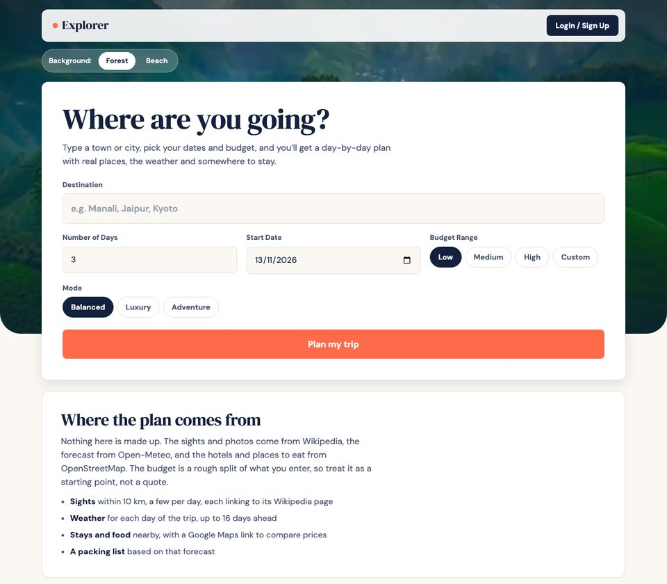

# Explorer

[](https://github.com/Sahitya0805/Explorer/actions/workflows/ci.yml)

A trip planner that turns any destination, start date, number of days and budget into a day-wise plan built from **real data**: notable places and photos from Wikipedia, the weather forecast for your dates, and nearby places to stay and eat — with an INR budget breakdown and a downloadable itinerary.

**Live demo:** https://explorer-ochre.vercel.app

## Screenshot



## Features

- **Finds the right place** – looks the destination up with the Open-Meteo geocoding API, ranks same-name matches by how many notable places are nearby (so "Manali" means the Himachal hill station), and offers the others under "Not this place?". Typing "Manali, Himachal" narrows it by state.
- **Real attractions with photos** – notable places within 10 km from the Wikipedia GeoSearch API, spread across the days of the trip, each linking to its article.
- **Trip map** – every attraction is pinned on an OpenStreetMap map (Leaflet), numbered and coloured by day, with popups linking to Wikipedia.
- **Shareable trip links** – the URL always holds the trip (place, dates, days, budget, mode); "Share Trip" copies it or opens the phone's share sheet, and opening the link rebuilds the same plan.
- **Destination suggestions** – matching places appear while typing (with keyboard support), so "Manali, Himachal Pradesh" and "Manali, Tamil Nadu" are easy to tell apart.
- **Packing list** – built from the forecast for your dates (warm layers, rain gear, sun protection) and the trip mode; ticks are remembered on the device.
- **My saved trips** – save a plan and reopen it later with one click.
- **Weather for your dates** – daily forecast (up to 16 days ahead) from Open-Meteo, with packing tips based on temperature and rain chance.
- **Stays and restaurants nearby** – real hotels, guest houses, restaurants and cafés from OpenStreetMap (Overpass API). Loaded in the background; if the public map service is busy, the app says so and links to Google Maps instead.
- **Budget breakdown in INR** – transport, stay, food and activities for Low / Medium / High / Custom budgets, with a per-night stay budget.
- **Downloadable itinerary** – exports the plan as a standalone HTML file, ready to share or print.
- **Login / sign-up** – accounts and saved trips are stored in the browser (localStorage).

No API keys are needed — every data source is free and public.

## Tech stack

JavaScript · HTML/CSS · Leaflet · Open-Meteo API · Wikipedia API · OpenStreetMap Overpass API · Vercel (static hosting)

## Run locally

It is a static site:

```bash
npx serve .
```

Then open http://localhost:3000.

## Tests

```bash
npm test
```

The planning logic lives in `planner-core.js` (no DOM or network), so Node's built-in test runner covers budgets, place filtering, geocoding disambiguation, itinerary building, weather tips and share-link encoding. GitHub Actions runs the tests on every push.

## Project structure

```
index.html   Planner page
planner-core.js  Pure planning logic (budgets, filtering, itinerary, share links)
hindex.js        Data fetching, rendering, map, sharing and itinerary download
test/            Unit tests
inde.css     Styles
auth.html    Login / sign-up page
auth.js      Browser-stored accounts
assets/      Background videos and images
```

## Data sources

Weather and geocoding: [Open-Meteo](https://open-meteo.com) · Places and photos: [Wikipedia](https://www.wikipedia.org) · Stays and restaurants: © [OpenStreetMap](https://www.openstreetmap.org/copyright) contributors
